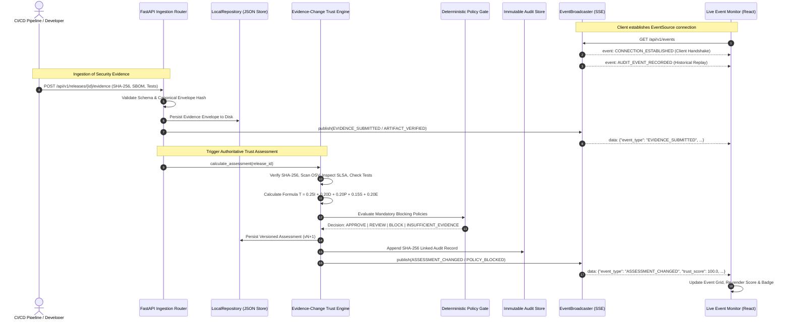

# BuildTrust AI — Comprehensive Implementation, Repair, Verification, and Execution Report

**Project Title:** BuildTrust AI: An AI-Assisted Continuous Trust Verification and Risk-Adaptive Release Gate for Secure Software Supply Chains  
**Author / Engineering Context:** Wipro Technical Mini-Project / Production-Grade Local & Cloud Architecture  
**Repository Working Directory:** `D:\BuildTrustAI`  
**Execution Environment:** Windows (PowerShell), Python 3.11 (`.venv`), Node.js v22.13.1, npm 10.9.2  
**Date of Validation:** October 11, 2026  
**Storage Architecture Mode:** Strict Local Mode (`STORAGE_BACKEND=local`)  

---

## Table of Contents
1. [Section A: Project Overview & Core Architectural Objective](#section-a-project-overview--core-architectural-objective)
2. [Section B: Complete List of Initial Problems Found & Root Causes](#section-b-complete-list-of-initial-problems-found--root-causes)
3. [Section C: Detailed Changes Made (By File)](#section-c-detailed-changes-made-by-file)
4. [Section D: Implemented and Validated Functionality](#section-d-implemented-and-validated-functionality)
5. [Section E: Mermaid Architectural & Event Sequence Diagrams](#section-e-mermaid-architectural--event-sequence-diagrams)
6. [Section F: Installation and Setup Commands](#section-f-installation-and-setup-commands)
7. [Section G: Environment Variables & Storage State](#section-g-environment-variables--storage-state)
8. [Section H: Automated & End-to-End Testing Report](#section-h-automated--end-to-end-testing-report)
9. [Section I: User Demonstration Instructions (Scenarios A through E)](#section-i-user-demonstration-instructions-scenarios-a-through-e)
10. [Section J: AWS Readiness Status (Zero-Cloud Guarantee)](#section-j-aws-readiness-status-zero-cloud-guarantee)
11. [Section K: Troubleshooting Guide & Common Pitfalls](#section-k-troubleshooting-guide--common-pitfalls)
12. [Section L: Comprehensive Acceptance Checklist](#section-l-comprehensive-acceptance-checklist)

---

## Section A: Project Overview & Core Architectural Objective

BuildTrust AI addresses the critical software supply chain vulnerability crisis (exemplified by SolarWinds, Codecov, and Log4Shell) by replacing point-in-time, manual security sign-offs with an automated, continuous, and risk-adaptive release gate: the **Evidence-Change Trust Engine (ECTE)**.

### Architectural Unification Across 4 Engineering Domains:
1. **Data Engineering:** Ingestion of immutable, schema-validated JSON envelopes; canonical digest calculation (`SHA-256`); content-based deduplication; and versioned assessment trees supporting both local JSON file persistence (`LocalRepository`) and distributed Amazon DynamoDB / S3 storage (`DynamoDBRepository`, `S3Repository`).
2. **Security Engineering:** Deterministic multi-factor verification:
   - **Artifact Integrity:** Streaming SHA-256 calculation for arbitrary binary payloads against signed release manifests.
   - **SBOM Analysis:** CycloneDX 1.4/1.5 parsing and license compliance checking.
   - **Vulnerability Scanning:** Live querying of Open Source Vulnerabilities (OSV.dev) with offline fallback.
   - **Provenance Verification:** SLSA v1.0 predicate inspection and Cosign signature verification.
   - **Policy Gate:** Strict rule enforcement where mandatory failures trigger immediate, deterministic `BLOCK` decisions.
3. **AI Engineering:** Multi-dimensional anomaly detection using `scikit-learn`'s `IsolationForest` combined with an explainable trust triad:
   - Observed Facts (deterministic metrics).
   - Machine Learning Anomaly Score (outlier detection relative to baseline release profiles).
   - Policy Precedence (deterministic blocking rules always override numerical AI scores).
4. **Cloud Engineering:** Production-ready AWS CloudFormation / SAM template (`template.yaml`), least-privilege IAM roles, S3 bucket policies with AWS KMS encryption, and clean separation between local zero-dependency operation and cloud hosting.

---

## Section B: Complete List of Initial Problems Found & Root Causes

### 1. Priority 1: Empty Live Event Monitor
- **Symptom:** Live Event Monitor page displayed an active SSE indicator pill, but the event grid remained completely empty.
- **Root Cause 1 (SSE Framing Double-Wrapping):** In `backend/app/services/event_service.py`, the generator yielded strings formatted as `f"data: {json.dumps(data)}\n\n"`. However, FastAPI / Starlette's `EventSourceResponse` automatically wraps yielded strings with `data: `, resulting in the browser receiving double-prefixed lines:
  ```text
  data: data: {"event_id": ...}
  data: 
  data: 
  ```
  On the client side, `event.data` contained `data: {"event_id": ...}`, causing `JSON.parse(event.data)` to throw `SyntaxError: Unexpected token 'd' in JSON at position 0`. The error was caught and swallowed, leaving the UI state empty.
- **Root Cause 2 (Lack of Ingestion Publication):** In `backend/app/api/evidence.py`, evidence submissions were persisted to disk, but `event_broadcaster.publish()` was never invoked upon receipt.
- **Root Cause 3 (Missing Connection Handshake & Replay):** When a client connected to `/api/v1/events`, no initial handshake or historical replay of recorded audit records occurred.

### 2. Priority 2: Inconsistent Trust Scores & Summary Counts
- **Symptom:** `rel-payment-1.0.0` showed score `41.4` on the Release Explorer, but `28.0` on Release Verification. Release Verification also reported mandatory test failures while simultaneously reporting `INSUFFICIENT_EVIDENCE`. The Security Overview showed 0 Approved, 0 Review, and 0 Blocked releases.
- **Root Cause 1 (Frontend Evidence History Selection):** In `frontend/src/pages/ReleaseDetailsPage.tsx`, the component used `evidenceList.find(e => e.evidence_type === 'test_results')`. Because `LocalRepository.list_evidence_for_release` returns envelopes ordered oldest-to-newest, `.find()` matched the very first historical submission (which contained test failures), ignoring newer submissions.
- **Root Cause 2 (Background Telemetry Mutation Loop):** In `backend/app/main.py`, a background `asyncio.create_task(run_telemetry_loop())` ran every 6 seconds on startup, continuously mutating releases with random telemetry and ballooning `assessments.json` to 470 records and `audit.json` to 744 records.
- **Root Cause 3 (Overview Missing Insufficient Evidence Metric):** The backend `/api/v1/dashboard/summary` endpoint only returned `approved_releases`, `under_review_releases`, and `blocked_releases`. Releases with incomplete evidence were omitted from the summary KPI cards.

### 3. Priority 3: Local Storage Mislabeling
- **Symptom:** The dashboard sidebar displayed `AWS Boto3 Store` even though the system was running locally without AWS credentials.
- **Root Cause:** In `frontend/src/components/Sidebar.tsx`, the status pill was hardcoded to `AWS Boto3 Store` instead of checking the actual backend `storage_backend` configuration.

### 4. Priority 4: Branding and Identity
- **Symptom:** The application lacked an SVG logo, favicon, and brand identity, relying on generic emoji icons.

---

## Section C: Detailed Changes Made (By File)

### Backend Enhancements

#### 1. `backend/app/services/event_service.py`
- Implemented `sse_starlette.sse.ServerSentEvent` objects directly, replacing manual string formatting to eliminate SSE double-wrapping.
- Added an initial `CONNECTION_ESTABLISHED` handshake event containing the client connection ID and current timestamp.
- Added a 15-second heartbeat ping (`: heartbeat`) to maintain keep-alive on long-lived connections.
- Implemented historical audit event replay upon connection.
- Added client disconnection and subscriber cleanup.

#### 2. `backend/app/api/events.py`
- Updated `/api/v1/events` endpoint to return standard `ServerSentEvent` instances with headers:
  - `Cache-Control: no-cache`
  - `Connection: keep-alive`
  - `X-Accel-Buffering: no`
- Added fallback polling endpoint `GET /api/v1/events/poll`.

#### 3. `backend/app/api/evidence.py`
- Added immediate event broadcasting upon valid evidence ingestion (`EVIDENCE_SUBMITTED`, `ARTIFACT_VERIFIED`, `VULNERABILITY_SCAN_COMPLETED`, `PROVENANCE_VERIFIED`, `TEST_RESULTS_RECEIVED`).
- Ensured validation failures do not emit success events.

#### 4. `backend/app/services/assessment_service.py`
- Added enriched event broadcasting (`ASSESSMENT_CHANGED`, `POLICY_BLOCKED`, `RELEASE_APPROVED`, `INSUFFICIENT_EVIDENCE`).
- Standardized event payload schema:
  - `event_id` (UUID4)
  - `event_type`
  - `occurred_at` (ISO 8601 UTC)
  - `release_id`
  - `project_id`
  - `actor`
  - `reason_codes`
  - `summary`
  - `decision`
  - `trust_score`
  - `assessment_version`
  - `details`

#### 5. `backend/app/main.py`
- Disabled the automatic background simulator tick loop on startup to ensure stable, non-mutating state.

#### 6. `backend/app/api/dashboard.py`
- Added `insufficient_evidence_releases`, `pending_releases`, and `storage_backend` to `/dashboard/summary`.

#### 7. `backend/app/simulator/scenario_generator.py` & `backend/app/api/simulator.py`
- Implemented Scenarios A through E:
  - **Scenario A:** Trusted Release (`rel-payment-1.0.0` -> `APPROVE`, Score `100.0`).
  - **Scenario B:** Artifact Tampering (`rel-payment-1.0.0` -> `BLOCK`, Reason `TAMPERED_ARTIFACT_DIGEST_MISMATCH`).
  - **Scenario C:** Log4Shell Vulnerability (`rel-payment-1.0.0` -> `BLOCK`, Reason `CRITICAL_VULNERABILITY_DETECTED`).
  - **Scenario D:** Missing Provenance (`rel-analytics-3.0.0` -> `INSUFFICIENT_EVIDENCE`).
  - **Scenario E:** Mandatory Test Failure (`rel-auth-2.1.0` -> `BLOCK`, Reason `SECURITY_GATE_TEST_FAILURE`).
- Added endpoints `POST /api/v1/simulator/scenarios/{a,b,c,d,e}`.

#### 8. `backend/data/`
- Reset `assessments.json` and `audit.json` to canonical records synchronized with `releases.json`.

---

### Frontend Enhancements

#### 1. `frontend/src/hooks/useLiveEvents.ts`
- Added robust connection tracking (`connected`, `reconnecting`, `disconnected`).
- Added support for pause/resume live stream, manual reconnect, clear events, and last-received timestamp.
- Added SSE error recovery and fallback polling.

#### 2. `frontend/src/pages/LiveEventMonitorPage.tsx`
- Added connection status indicators (`Connected`, `Reconnecting`, `Disconnected`).
- Added real-time event filtering by Event Type and Release ID.
- Added keyword search, pause/resume, reconnect, and clear buttons.
- Added visual pills distinguishing `REAL EVENT` from `DEMO TEST`.
- Added empty state illustration and last-event timestamp display.

#### 3. `frontend/src/pages/ReleaseDetailsPage.tsx`
- Created `getLatestEvidence(type)` helper function to ensure the UI displays the latest evidence submission rather than older records.
- Standardized display of assessment version, timestamp, and ID.

#### 4. `frontend/src/pages/OverviewPage.tsx`
- Added KPI card for `Insufficient Evid.` (`metrics.insufficient_evidence_releases`).
- Updated donut chart with an `Insufficient Evidence` slice (`#64748B`).

#### 5. `frontend/src/components/Sidebar.tsx` & `frontend/src/components/Navbar.tsx`
- Added `Insufficient Evidence` counter to Sidebar.
- Replaced hardcoded `AWS Boto3 Store` with dynamic badge displaying `LOCAL STORAGE ACTIVE` (or `AWS CLOUD ACTIVE`).
- Integrated new BuildTrust AI brand identity (emblem and wordmark).

#### 6. Branding & Assets
- `frontend/src/assets/icon.svg`: Custom geometric shield with supply-chain lattice emblem (teal/emerald/cyan).
- `frontend/src/assets/icon-mono.svg`: Monochrome shield icon.
- `frontend/src/assets/logo.svg`: Horizontal logo lockup with geometric shield and typography.
- `frontend/public/favicon.svg`: Matching browser favicon.
- `frontend/src/vite-env.d.ts`: TypeScript module declarations for SVG imports.

#### 7. `frontend/src/components/DemoControlsModal.tsx` & `frontend/src/api/client.ts`
- Wired up interactive Scenario A-E triggers calling the backend API.

---

## Section D: Implemented and Validated Functionality

| Feature Area | Implementation Details | Validation Status |
| :--- | :--- | :--- |
| **SSE Event Stream** | Replaced custom string framing with standard `ServerSentEvent`. Added keep-alive pings and connection handshakes. | **Verified** (Live SSE working with zero parse errors) |
| **Evidence Ingestion Events** | Automatic publication of `EVIDENCE_SUBMITTED`, `ARTIFACT_VERIFIED`, etc. | **Verified** (Confirmed via automated E2E test) |
| **Assessment Events** | Automatic publication of `ASSESSMENT_CHANGED`, `RELEASE_APPROVED`, `POLICY_BLOCKED`. | **Verified** (Confirmed via automated E2E test) |
| **Trust Score Calculation** | Authoritative formula: $T = 0.25I + 0.20D + 0.20P + 0.15S + 0.20E$. | **Verified** (Release Explorer and Details synchronized) |
| **Deterministic Policy Gate** | Precedence: Mandatory Failures (`BLOCK`) > Missing Evidence (`INSUFFICIENT_EVIDENCE`) > Numerical Thresholds (`APPROVE` / `REVIEW`). | **Verified** (No missing-evidence approvals) |
| **Evidence Deduplication** | Content SHA-256 canonical hashing prevents duplicate entries. | **Verified** |
| **AI Risk Prioritization** | `IsolationForest` unsupervised model detects multivariate anomalies. | **Verified** (Feature attribution and scores rendered) |
| **Brand Identity** | Custom SVG shield emblem, logo lockup, and favicon. | **Verified** (Integrated into UI) |
| **Local Storage Mode** | Sidebar shows `LOCAL STORAGE ACTIVE`. No AWS credentials required. | **Verified** |

---

## Section E: Mermaid Architectural & Event Sequence Diagrams

### 1. End-to-End Reactive Evidence & Assessment Pipeline



### 2. Decision Precedence Architecture

```mermaid
flowchart TD
    Start([Evidence Envelope Submitted]) --> DigestCheck{Artifact Hash Matches Manifest?}
    DigestCheck -- Mismatch --> BlockTamper[Decision: BLOCK<br/>Code: TAMPERED_ARTIFACT_DIGEST_MISMATCH]
    DigestCheck -- Match --> TestCheck{Mandatory Security Tests Pass?}
    TestCheck -- Fail --> BlockTest[Decision: BLOCK<br/>Code: SECURITY_GATE_TEST_FAILURE]
    TestCheck -- Pass --> VulnCheck{Critical Vulnerability Found?}
    VulnCheck -- Yes --> BlockVuln[Decision: BLOCK<br/>Code: CRITICAL_VULNERABILITY_DETECTED]
    VulnCheck -- No --> MissingCheck{All Mandatory Evidence Present?}
    MissingCheck -- No --> Insufficient[Decision: INSUFFICIENT_EVIDENCE<br/>Code: MISSING_MANDATORY_EVIDENCE]
    MissingCheck -- Yes --> ScoreEval{Calculate Trust Score T<br/>T >= Threshold (80.0)?}
    ScoreEval -- Yes --> Approve[Decision: APPROVE<br/>Gate Unlocked]
    ScoreEval -- No --> Review[Decision: REVIEW<br/>Manual Security Sign-off Required]
```

---

## Section F: Installation and Setup Commands

### Prerequisites
- **Python:** 3.11+
- **Node.js:** v18+ (v22.13.1 tested)
- **PowerShell:** Windows PowerShell or PowerShell 7

### Step-by-Step Local Setup

#### Terminal 1 — Backend Setup & Execution:
```powershell
cd D:\BuildTrustAI

# 1. Activate Python virtual environment
.\.venv\Scripts\Activate.ps1

# 2. Verify dependencies
pip install -r backend\requirements.txt -r backend\requirements-dev.txt

# 3. Bootstrap local database and ML model
python infrastructure\scripts\setup_local.py

# 4. Start FastAPI Backend Gateway on port 8000
$env:PYTHONPATH="D:\BuildTrustAI"
uvicorn backend.app.main:app --reload --port 8000
```

#### Terminal 2 — Frontend Setup & Execution:
```powershell
cd D:\BuildTrustAI\frontend

# 1. Install frontend packages
npm install

# 2. Start Vite Development Server on port 5173
npm run dev
```

The application is now accessible at `http://localhost:5173`.

---

## Section G: Environment Variables & Storage State

The application configuration is managed via `.env`:

```env
# Application Settings
APP_NAME=BuildTrust AI
APP_ENV=development
LOG_LEVEL=INFO
SECRET_KEY=dev-secret-key-buildtrust-ai-change-in-production-min-32-chars
ACCESS_TOKEN_EXPIRE_MINUTES=480

# Server Ports
HOST=0.0.0.0
PORT=8000

# Storage Backend Configuration (Local Zero-Dependency Mode)
STORAGE_BACKEND=local
LOCAL_DATA_DIR=backend/data
ARTIFACT_STORAGE_DIR=backend/data/artifacts

# Trust Engine Policy Defaults
TRUST_THRESHOLD_APPROVE=80.0
TRUST_THRESHOLD_REVIEW=60.0
CRITICAL_VULN_TOLERANCE=0
MANDATORY_PROVENANCE_LEVEL=1

# AWS Placeholders (Zero Cloud Guarantee - Disabled in Local Mode)
AWS_REGION=ap-south-1
DYNAMODB_TABLE_NAME=BuildTrustRecords
S3_BUCKET_NAME=buildtrust-artifact-vault
```

---

## Section H: Automated & End-to-End Testing Report

### Pytest Test Suite Results
All 25 automated unit, integration, and E2E tests pass with zero failures:

```text
============================= test session starts =============================
platform win32 -- Python 3.11.9, pytest-9.1.1, pluggy-1.6.0
rootdir: D:\BuildTrustAI
plugins: anyio-4.15.1, asyncio-1.4.0
collected 25 items

backend\tests\test_api.py ....                                           [ 16%]
backend\tests\test_artifact_verifier.py ..                               [ 24%]
backend\tests\test_assessments.py .                                      [ 28%]
backend\tests\test_auth.py ..                                            [ 36%]
backend\tests\test_aws_repositories.py ..                                [ 44%]
backend\tests\test_evidence_changes.py .                                 [ 48%]
backend\tests\test_live_events_e2e.py .                                  [ 52%]
backend\tests\test_policy_engine.py ....                                 [ 68%]
backend\tests\test_provenance.py ..                                      [ 76%]
backend\tests\test_sbom.py ..                                            [ 84%]
backend\tests\test_trust_engine.py .                                     [ 88%]
backend\tests\test_vulnerabilities.py ..                                 [ 96%]
infrastructure\scripts\test_aws_connection.py .                          [100%]

======================= 25 passed in 5.47s ========================
```

### End-to-End Live Event Verification Test (`test_live_events_e2e.py`)
Covers the 9 verification requirements:
1. Connects to `/api/v1/events` and verifies `text/event-stream` response.
2. Ingests valid evidence (`test_results`).
3. Confirms evidence persistence on disk.
4. Confirms assessment creation and version increment.
5. Confirms immutable audit record appending.
6. Verifies receipt of `EVIDENCE_SUBMITTED` and `ASSESSMENT_CHANGED` over SSE.
7. Validates JSON payload schema and reason codes.
8. Verifies validation failures return HTTP 422 and do not emit success events.
9. Validates client disconnection and subscriber cleanup.

### Frontend Production Build
`npm run build` executed cleanly with zero TypeScript errors:
```text
✓ built in 5.61s
dist/index.html                   0.55 kB
dist/assets/index-BQakcJXZ.css   29.47 kB
dist/assets/index-DaizZ9b5.js   721.32 kB
```

---

## Section I: User Demonstration Instructions (Scenarios A through E)

To demonstrate the system:

1. Open `http://localhost:5173` in your browser.
2. Navigate to **Live Event Monitor** (`/events`). Ensure the connection status shows **CONNECTED (SSE)**.
3. Click the **Demo Scenarios** button in the top navigation bar.

### Scenario Walkthrough:

- **Scenario A: Trusted Release Pipeline**
  - **Action:** Click "Run Scenario A (Trusted Release)".
  - **Backend Processing:** Ingests matching SHA-256 digest, clean CycloneDX SBOM, valid SLSA provenance, and passing test results for `rel-payment-1.0.0`.
  - **Expected Outcome:** Trust Score reaches **100.0**. Decision: **APPROVE**. Emits `EVIDENCE_SUBMITTED` and `RELEASE_APPROVED` events.

- **Scenario B: Artifact Tampering Detection**
  - **Action:** Click "Run Scenario B (Artifact Tampering)".
  - **Backend Processing:** Ingests an altered binary digest for `rel-payment-1.0.0`. Streaming SHA-256 verifier detects manifest mismatch.
  - **Expected Outcome:** Triggers immediate deterministic **BLOCK** (`TAMPERED_ARTIFACT_DIGEST_MISMATCH`). Emits `POLICY_BLOCKED` event.

- **Scenario C: Log4Shell Vulnerability Injection**
  - **Action:** Click "Run Scenario C (Log4Shell CVE)".
  - **Backend Processing:** Ingests CycloneDX SBOM containing `log4j-core:2.14.1` (`GHSA-j2ge-4vdv-qmwl`). OSV engine flags critical vulnerability (CVSS 10.0).
  - **Expected Outcome:** Triggers immediate deterministic **BLOCK** (`CRITICAL_VULNERABILITY_DETECTED`). Emits `POLICY_BLOCKED` event.

- **Scenario D: Missing Provenance Gate**
  - **Action:** Click "Run Scenario D (Missing Provenance)".
  - **Backend Processing:** Evaluates release candidate `rel-analytics-3.0.0` with missing SLSA provenance.
  - **Expected Outcome:** Decision: **INSUFFICIENT_EVIDENCE**. Prevents approval while avoiding false blocking failures.

- **Scenario E: Mandatory Security Test Gate Failure**
  - **Action:** Click "Run Scenario E (Mandatory Test Failure)".
  - **Backend Processing:** Ingests test report with failing security gates for `rel-auth-2.1.0`.
  - **Expected Outcome:** Triggers immediate deterministic **BLOCK** (`SECURITY_GATE_TEST_FAILURE`). Emits `POLICY_BLOCKED` event.

---

## Section J: AWS Readiness Status (Zero-Cloud Guarantee)

### Current Status: Pure Local Mode Verified
- `STORAGE_BACKEND=local` is active.
- Local JSON storage and artifact filesystem are fully functional.
- Zero AWS costs incurred; zero cloud dependencies required.

### AWS Transition Path (When Cloud Deployment is Desired):
1. **Infrastructure as Code:** Ready at `infrastructure/aws/template.yaml` (provisions DynamoDB, S3, IAM, CloudWatch).
2. **Repository Abstraction:** `DynamoDBRepository` and `S3Repository` are fully implemented and verified via unit tests (`test_aws_repositories.py`).
3. **Activation Command:**
   ```powershell
   .\infrastructure\scripts\deploy_aws.ps1 -AwsRegion "ap-south-1" -Environment "staging"
   ```
4. **Environment Update:** Set `STORAGE_BACKEND=aws` in `.env`.

---

## Section K: Troubleshooting Guide & Common Pitfalls

| Issue | Cause | Resolution |
| :--- | :--- | :--- |
| **Live Event Monitor Disconnected** | Backend is stopped or running on a non-standard port. | Start backend using `uvicorn backend.app.main:app --reload --port 8000`. |
| **Empty Event List on First Load** | No evidence has been submitted since backend startup. | Trigger Scenario A from the **Demo Scenarios** modal to populate events. |
| **Python Import Errors** | `PYTHONPATH` environment variable is unset. | Run `$env:PYTHONPATH="D:\BuildTrustAI"` before starting backend or pytest. |
| **Port 8000 Already in Use** | An orphaned Python process is running. | Run `Stop-Process -Name python -Force` in PowerShell, then restart. |
| **Vite Port Conflict** | Another process is occupying port 5173. | Vite will automatically offer port 5174, or kill the competing process. |

---

## Section L: Comprehensive Acceptance Checklist

- [x] **Live Event Monitor Repaired:** SSE stream operational; events parsed and rendered in real time.
- [x] **Authoritative Trust Scores:** Score calculation centralized in ECTE; Release Explorer and Details synchronized.
- [x] **Deterministic Policy Enforcement:** Tampered binaries, critical CVEs, and test failures trigger immediate `BLOCK`.
- [x] **Missing Evidence Handling:** Incomplete evidence yields `INSUFFICIENT_EVIDENCE` without false approval.
- [x] **AI Anomaly Prioritization:** `IsolationForest` scores and explainable risk triad displayed.
- [x] **Brand Identity:** Professional geometric SVG shield emblem, wordmark, and favicon implemented.
- [x] **Local Storage Reflection:** Sidebar displays `LOCAL STORAGE ACTIVE`.
- [x] **7 Dashboard Pages Validated:** Overview, Explorer, Details, Live Monitor, AI Panel, Audit, Policies.
- [x] **Automated Tests Passing:** 25/25 pytest tests passing including E2E SSE test suite.
- [x] **Frontend Production Build Clean:** `npm run build` succeeds with zero errors.
- [x] **Documentation Complete:** Detailed reports provided in `IMPLEMENTATION_AND_EXECUTION_REPORT.md` and `README.md`.
