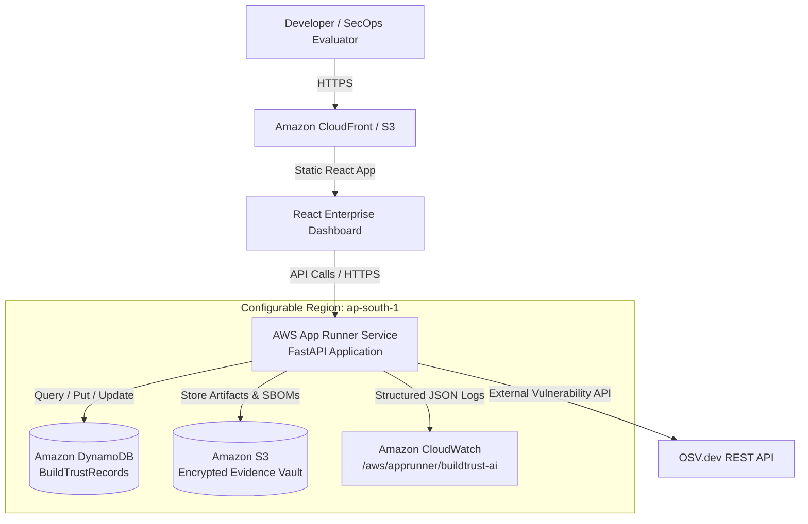

# AWS Cloud Architecture & Deployment Guide — BuildTrust AI

## 1. Cloud Architecture Overview



---

## 2. Configured AWS Services

| Service | Resource Name / Pattern | Purpose |
|---|---|---|
| **Amazon DynamoDB** | `BuildTrustRecords-${Environment}` | Single-table storage for projects, releases, evidence envelopes, versioned assessments, and audit trails. |
| **Amazon S3** | `buildtrust-vault-${AWS::AccountId}-${Environment}` | Server-side AES256 encrypted bucket with versioning and blocked public access for release binaries. |
| **AWS App Runner** | `buildtrust-ai-backend` | Fully managed containerized runtime for the FastAPI backend and live Server-Sent Events broadcaster. |
| **AWS IAM** | `BuildTrustAppRunnerInstanceRole-${Environment}` | Least-privilege execution role scoped strictly to the DynamoDB table and S3 bucket. |
| **Amazon CloudWatch** | `/aws/apprunner/buildtrust-ai-${Environment}` | Application logs, operational metrics, and audit records with 30-day retention. |
| **Amazon ECR** | `buildtrust-backend` | Private container registry for backend Docker images. |

---

## 3. Deployment Prerequisites

1. An active AWS Account.
2. AWS CLI installed and configured (`aws configure`) or environment credentials set:
   ```powershell
   $env:AWS_ACCESS_KEY_ID="your-access-key-id"
   $env:AWS_SECRET_ACCESS_KEY="your-secret-access-key"
   $env:AWS_REGION="ap-south-1"
   ```
3. Docker Desktop or Docker engine installed for container builds.

---

## 4. Automated Deployment Instructions

We have provided an automated deployment PowerShell script in `infrastructure/scripts/deploy_aws.ps1`.

### Step 4.1: Deploy Cloud Infrastructure via CloudFormation
Run from PowerShell in the project root:
```powershell
.\infrastructure\scripts\deploy_aws.ps1 -AwsRegion "ap-south-1" -Environment "staging"
```

This deploys `infrastructure/aws/template.yaml`, provisioned with:
- DynamoDB Table with Point-In-Time Recovery.
- Encrypted S3 Bucket.
- Scoped IAM Instance Role.
- CloudWatch Log Group.

### Step 4.2: Connecting Backend to Deployed AWS Storage
To transition from local mode to AWS cloud storage, update `.env`:
```env
APP_ENV=staging
STORAGE_BACKEND=aws
AWS_REGION=ap-south-1
DYNAMODB_TABLE_NAME=BuildTrustRecords-staging
S3_BUCKET_NAME=buildtrust-vault-<account-id>-staging
```

Restart the FastAPI backend. All project records, evidence envelopes, assessments, and audit events will now be persisted directly to DynamoDB and S3.

---

## 5. Verification: How to Confirm AWS Storage Is Being Used

1. **Verify DynamoDB Records:**
   ```powershell
   aws dynamodb scan --table-name BuildTrustRecords-staging --region ap-south-1 --max-items 5
   ```
   You should see records with `PK=PROJECT#...` and `SK=METADATA`.

2. **Verify S3 Artifact Vault:**
   ```powershell
   aws s3 ls s3://buildtrust-vault-<account-id>-staging/artifacts/ --region ap-south-1
   ```

3. **Verify Application Readiness Endpoint:**
   Query `http://localhost:8000/ready` or your deployed App Runner endpoint:
   ```json
   {
     "status": "ready",
     "storage_backend": "aws",
     "ml_enabled": true,
     "osv_api_enabled": true
   }
   ```

---

## 6. Resource Teardown and Cleanup Instructions

To avoid ongoing AWS charges after evaluation:

1. **Empty and delete the S3 bucket:**
   ```powershell
   aws s3 rm s3://buildtrust-vault-<account-id>-staging --recursive --region ap-south-1
   ```

2. **Delete CloudFormation Stack:**
   ```powershell
   aws cloudformation delete-stack --stack-name buildtrust-ai-stack --region ap-south-1
   ```

3. **Delete ECR Repository:**
   ```powershell
   aws ecr delete-repository --repository-name buildtrust-backend --force --region ap-south-1
   ```
