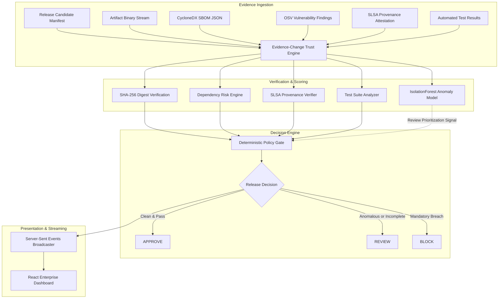

# Project Overview — BuildTrust AI

**Project Title:** BuildTrust AI: An AI-Assisted Continuous Trust Verification and Risk-Adaptive Release Gate for Secure Software Supply Chains  
**Short Name:** BuildTrust AI  
**Proposed Technical Contribution:** Evidence-Change Trust Engine (ECTE)  
**Target Organization:** Technical Mini-Project for Wipro Submission  

---

## 1. Executive Summary

Modern software organizations rely on intricate webs of third-party libraries, container images, CI/CD automated build systems, and open-source packages. Even when source code passes developer peer review, modern software supply chain compromises (such as SolarWinds, Codecov, and Log4j) demonstrate that release artifacts can be subverted at build-time or post-release.

**BuildTrust AI** is a prototype release trust-verification platform that continuously aggregates, normalizes, and correlates multi-dimensional release evidence. The platform evaluates:
1. **Artifact Cryptographic Integrity:** Real-time streaming SHA-256 digest validation.
2. **Dependency Vulnerability Findings:** Integration with the OSV.dev vulnerability database and CycloneDX SBOM parser.
3. **Build Provenance:** SLSA v1.0 and in-toto attestation validation with optional Cosign cryptographic signature checks.
4. **Security Test Verification:** Mandatory security regression and unit test verification.
5. **AI-Assisted Anomaly Prioritization:** Transparent baseline scoring paired with an IsolationForest machine-learning model to flag unusual multidimensional release feature deviations.
6. **Deterministic Policy Gates:** Rigid security policy rules that mandate release blocking regardless of AI score.

---

## 2. Four Engineering Domains Addressed

| Domain | Implemented Responsibilities in BuildTrust AI |
|---|---|
| **1. Data Engineering** | Canonical evidence envelope ingestion, deduplication of repeated submissions, schema normalization, versioned assessment history, and storage abstraction across local stores and AWS DynamoDB + S3. |
| **2. Security Engineering** | Cryptographic SHA-256 streaming verification, CycloneDX SBOM analysis, SLSA build provenance validation, Cosign signature verification status handling, and deterministic policy enforcement. |
| **3. AI Engineering** | Explainable composite trust scoring formula ($T = 0.25I + 0.20D + 0.20P + 0.15S + 0.20E$), scikit-learn IsolationForest anomaly detection on synthetic release vectors, and deterministic explanation generation. |
| **4. Cloud Engineering (AWS)** | Amazon DynamoDB single-table design, encrypted Amazon S3 artifact vault, AWS App Runner deployment templates, CloudWatch logging, and least-privilege IAM policies. |

---

## 3. Core Workflow

