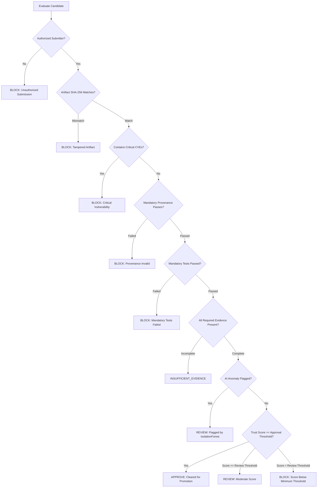

# Security Policies & Policy Engine Specification — BuildTrust AI

## 1. Release Gate Decision Hierarchy

The Policy Engine determines release promotion through a deterministic decision hierarchy. Mandatory security rules are evaluated first. If any mandatory rule fails, the candidate is unconditionally blocked.

---

## 2. Decision States

1. `APPROVE`:
   Release candidate passes all mandatory gates, all required evidence is valid, trust score meets or exceeds the approval threshold ($\ge 85.0$), and no AI anomaly flags require human intervention.
2. `REVIEW`:
   Release candidate passes mandatory security gates, but falls into the review threshold ($60.0 \le T < 85.0$) or has been flagged by the AI anomaly model for multidimensional feature deviations. Requires manual SecOps sign-off.
3. `BLOCK`:
   Release candidate violates one or more mandatory security policies (e.g. hash mismatch, critical CVE, failed provenance) or possesses a composite trust score below the minimum threshold ($T < 60.0$).
4. `INSUFFICIENT_EVIDENCE`:
   Processing state indicating that one or more required evidence envelopes have not been submitted or validated.

---

## 3. Mandatory Blocking Rules

| Rule Identifier | Trigger Condition | Rationale |
|---|---|---|
| `MANDATORY_INTEGRITY_POLICY` | Calculated SHA-256 $\ne$ Expected SHA-256 | Prevents binary tampering, compromised builds, or unauthorized byte modifications. |
| `VULNERABILITY_THRESHOLD_POLICY` | Critical CVE finding count $\ge 1$ | Zero-tolerance posture for unpatched remote code execution or critical severity flaws. |
| `HIGH_VULNERABILITY_LIMIT_POLICY` | High CVE count $\ge 3$ (configurable) | Caps acceptable security debt from high-severity dependency advisories. |
| `PROVENANCE_POLICY` | Builder ID missing or Commit tag mismatch | Ensures release was built by authorized CI runner from approved release tag. |
| `TEST_SUITE_POLICY` | Any mandatory test suite fails | Guarantees security regression checks cannot be bypassed. |
| `AUTHORIZATION_POLICY` | Caller lacks `DEVELOPER` or `ADMIN` role | Defends against unauthorized release candidate submissions. |
